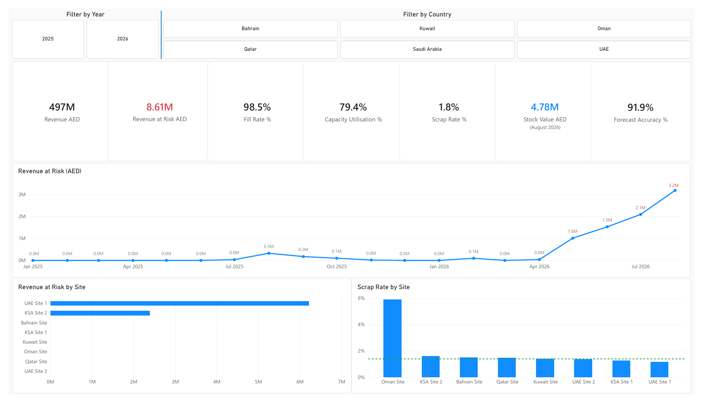
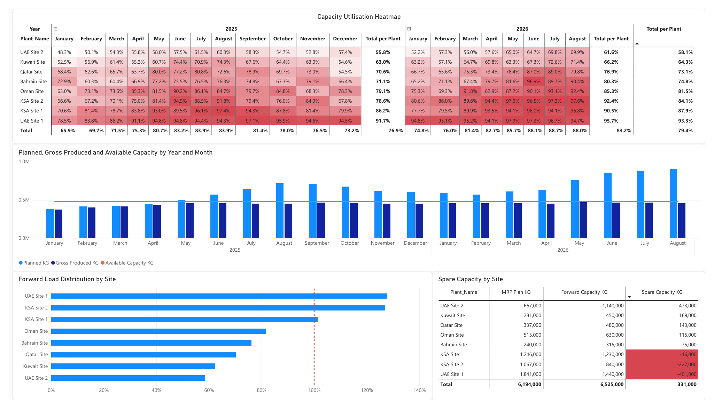
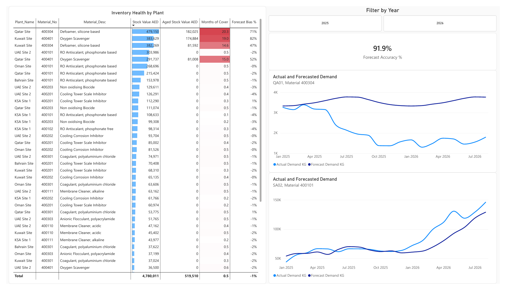
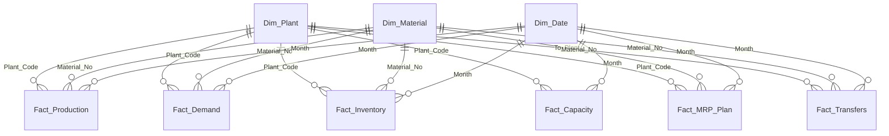

# MRP Supply Chain Analytics

**Turning SAP material requirements planning (MRP) data into decisions, and automating the workflow with AI.**

A Power BI case study for a fictional network of eight water treatment chemical blending sites across the GCC. It takes a raw SAP style extract, cleans and reconciles it, models it as a star schema, and builds a three page dashboard that shows where revenue, margin and cash are being lost. An automation proposal shows how the reporting could run itself, with an AI layer for commentary and exception alerts.

> **All data is synthetic.** The company, sites, products, volumes and costs are fictional and do not represent any real organisation.



## The business problem

Manufacturers running SAP often report MRP performance the same way: a manual export per site, clean up in Excel, reconcile with Finance, build slides, decide weeks later. That causes three problems:

- **Late signals.** Problems show up in the month end pack, after the revenue is already lost.
- **Conflicting numbers.** Each team's spreadsheet uses its own definitions.
- **Blind spots.** Standard MRP plans against unlimited capacity, so plans that can never be built look normal.

## What the dashboard finds

| Finding | Evidence |
|---|---|
| **Capacity is in the wrong place** | UAE Site 1 runs at 93% utilisation (95% to 97% every summer). UAE Site 2, in the same country, averages 58%. MRP asked UAE Site 1 for more than it could make in 16 of 20 months. |
| **AED 8.6M revenue at risk** | All of it at two sites, and 91% of it in summer 2026. The network fill rate of 98.5% hides it. |
| **The next plan will fail** | The September MRP run loads UAE Site 1 to 173% of capacity, while the network as a whole is only 95% loaded. UAE Site 2 has 473 t spare over the next three months, against a 401 t overload. |
| **Stale forecasts tie up AED 1.5M of cash** | Four products hold 32% of stock value with 15 to 20 months of cover. Demand halved after a customer loss and the forecast was never revised. |
| **One site's quality problem** | The Oman site scraps 6.0% of output against 1.4% elsewhere, and costs 16% to 21% more per kg on the same products. |

In Pareto terms: two sites explain all the lost revenue, one site most of the scrap cost, and four products a third of the stock value. Full analysis: [docs/findings.md](docs/findings.md).

<table>
<tr>
<td></td>
<td></td>
</tr>
<tr>
<td align="center"><b>Capacity and forward plan:</b> utilisation heatmap, plan vs capacity, forward load by site</td>
<td align="center"><b>Inventory and forecast:</b> stock health, months of cover, forecast vs actual demand</td>
</tr>
</table>

## How it was built

**1. Data.** A synthetic dataset shaped like an SAP MRP extract: 8 sites, 16 chemicals, 20 months of actuals (Jan 2025 to Aug 2026) and a 3 month forward MRP run. It comes in two forms: a clean, model ready workbook and a raw production order export with realistic problems.

**2. Cleaning and reconciliation (Power Query).** The raw export contains duplicated orders, cancelled orders, quantities in tonnes at one site, padded and unpadded material numbers, trailing spaces in site codes and text dates. Each fix is a repeatable Power Query step. After cleaning, every quantity reconciles exactly to production data, and nine open orders with no settled cost (an AED 947K gap) are flagged before anything is published.

**3. Star schema model.** Three dimensions and six fact tables, all many to one with single direction filtering:



**4. DAX measures.** 33 measures, each KPI defined once and reused by every visual, so every page uses the same definition. They cover plan attainment, capacity utilisation, forward load, fill rate, revenue at risk, forecast accuracy and bias, scrap cost, stock value, aged stock and months of cover. Stock measures are treated as balances (the last month in view) rather than summed over time. See [powerbi/measures.dax](powerbi/measures.dax).

**5. Automation proposal.** A daily scheduled SAP extract, Power Query validation that blocks publishing when totals don't reconcile, one governed model, and an AI layer that:
- drafts the monthly MRP commentary from the KPI tables, reviewed by a planner before it goes out;
- raises exception alerts (plans above capacity, excess cover, scrap and forecast bias) with a likely cause and a suggested action;
- feeds requirements extracted from customer RFQs into the demand forecast, so demand ramps show up earlier.

The proposal also covers governance (one definition per KPI, row level security, AI guardrails) and a 30/60/90 day rollout. See [docs/automation_proposal.pdf](docs/automation_proposal.pdf).

## Repository contents

```
├── data/
│   ├── MRP_Dataset.xlsx               clean workbook, one Excel table per sheet
│   └── SAP_Production_Orders_raw.csv  raw production order export with data quality issues
├── powerbi/
│   ├── MRP_Dashboard.pbix             the Power BI report and model
│   └── measures.dax                   all DAX measures, exported from the model
├── scripts/
│   ├── generate_mrp_data.py           synthetic data generator (MRP simulation)
│   └── requirements.txt
└── docs/
    ├── findings.md                    full analysis with figures
    ├── data_dictionary.md             tables, columns and cleaning steps
    ├── automation_proposal.pdf        pipeline, AI layer, governance, rollout plan
    └── screenshots/
```

## How to open the dashboard

1. Clone or download the repository.
2. Open `powerbi/MRP_Dashboard.pbix` in [Power BI Desktop](https://powerbi.microsoft.com/desktop/) (free, Windows).
3. The report opens with the data already loaded. To refresh it, point the source at your copy of the data: **Home > Transform data > Data source settings > Change Source**, select `data/MRP_Dataset.xlsx`, then **Refresh**.

## Regenerating the data

`scripts/generate_mrp_data.py` simulates the network month by month: demand with seasonality and growth, a trailing average forecast, MRP net requirements with lot sizes and safety stock, capacity constrained production, deliveries and backorders, emergency transfers between sites, and stock. It builds in the patterns above, writes the raw extract, and checks that stock balances and the extract reconciles.

```bash
pip install -r scripts/requirements.txt
python scripts/generate_mrp_data.py --out output --seed 20260927
```

It writes to `output/` so the committed data is never overwritten. The committed dataset came from an earlier version of the simulation, so a regenerated dataset has the same schema and the same patterns, with slightly different numbers.

## Tools

Power BI Desktop (Power Query, DAX, star schema modelling) · Python (pandas, NumPy, openpyxl) · Excel

AI assistance (Claude) was used to generate the synthetic dataset and the simulation script, and to draft the DAX measures and documentation. I built, checked and refined the Power BI model and report.

## Author

**Fahim Abdul Gani** · MSc Artificial Intelligence, University of Edinburgh · [GitHub](https://github.com/Fahim0297)
